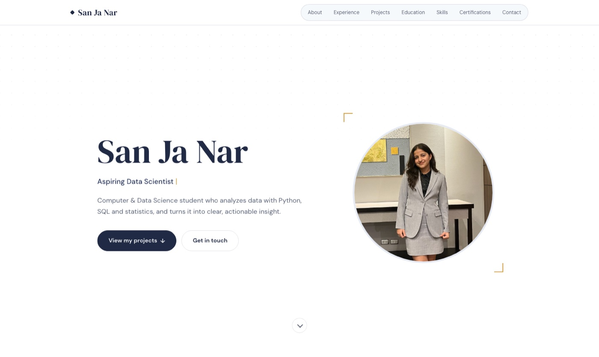

# San Ja Nar — Data Portfolio

Personal portfolio for **Data Analyst, Data Scientist and Machine Learning** roles.

 🔗 Live site: [selena1405.github.io/Data_Analysis_Portfolio](https://selena1405.github.io/Data_Analysis_Portfolio/)

[](https://selena1405.github.io/Data_Analysis_Portfolio/)

---

## About

I'm a Computer & Data Science student at Global Academy @ Siam University (Bangkok), with a double degree in Information Technology at La Trobe University. I analyze data with Python, SQL and statistics and turn it into clear, actionable insight.

This site brings together my projects, experience, education and skills in one place.

## What's on the site

| Section | Contents |
| --- | --- |
| **About** | Short intro, key facts (CGPA, languages, interests) and quick stats |
| **Experience** | Social Media Intern at Marketing Bear: competitor and engagement analysis |
| **Projects** | Featured project with a live demo, plus marketing analytics and this portfolio |
| **Education** | B.Sc. Computer & Data Science, and B.IT (Software Engineering) double degree |
| **Skills** | Data analysis, statistics & ML, programming, visualization, analytical skills |
| **Achievements** | Academic awards and certificates |
| **Contact** | Email, LinkedIn and GitHub |

### Featured project

**Teaching Evaluation Dashboard**: a Tableau dashboard rebuilt as an interactive Streamlit app, with a department heatmap, an adjustable threshold that flags instructors needing teaching support, subject-level material scores and semester trends.
[Live dashboard](https://academic-and-quality-assurance-staff-dashboard.streamlit.app/) · [Code](https://github.com/SELENA1405/Tableau-to-Streamlit-Visualization)

## Built with

- **HTML, CSS and vanilla JavaScript**: no frameworks or build step
- **Google Fonts**: DM Serif Display, DM Sans, JetBrains Mono
- **GitHub Pages** for hosting

### Details

- Responsive layout for desktop, tablet and phone (the menu becomes a swipeable strip on phones)
- Scroll animations: staggered reveals, count-up numbers, a timeline marker that follows the scroll, and dropdowns that open and close as you scroll
- Hover preview of the featured project's dashboard
- "Email me" also copies the address to the clipboard, with a confirmation
- Accessible by default: keyboard focus styles, readable contrast, and animations switched off for visitors who prefer reduced motion
- Content stays visible even if JavaScript fails to load

## Project structure

```
Data_Analysis_Portfolio/
├── index.html              # page content and structure
├── styles.css              # design tokens, layout, components and animations
├── script.js               # typing effect, scroll animations, nav and interactions
└── assets/
    ├── image.png           # profile photo
    ├── preview.jpg         # screenshot used in this README
    └── projects/
        └── teaching-dashboard.jpg
```

## Run it locally

No install needed. Clone the repo and open `index.html` in a browser:

```bash
git clone https://github.com/SELENA1405/Data_Analysis_Portfolio.git
cd Data_Analysis_Portfolio
open index.html          # macOS (on Windows: start index.html)
```

Or serve it locally, which is closer to how GitHub Pages serves it:

```bash
python3 -m http.server 8000
# then visit http://localhost:8000
```

## Deployment

The site deploys automatically with **GitHub Pages** from the `main` branch (root folder). Every push to `main` updates the live site within a minute or two.

## Updating the content

- **Add a project:** copy a `<article class="project-card">` block in the Projects section of `index.html`. Put screenshots in `assets/projects/`.
- **Add a skill:** add a `<span class="skill-tag" data-tooltip="…">Skill</span>` to the right group in the Skills section.
- **Change the typed roles under the name:** edit the `phrases` list at the top of `script.js`.
- **Colours and text sizes:** change the variables at the top of `styles.css` (`--navy`, `--amber`, `--fs-*`).

## Contact

- **LinkedIn:** [san-ja-nar](https://www.linkedin.com/in/san-ja-nar-14102005s/)
- **GitHub:** [SELENA1405](https://github.com/SELENA1405)
- **Email:** selena141ss@gmail.com

---

© 2026 San Ja Nar
